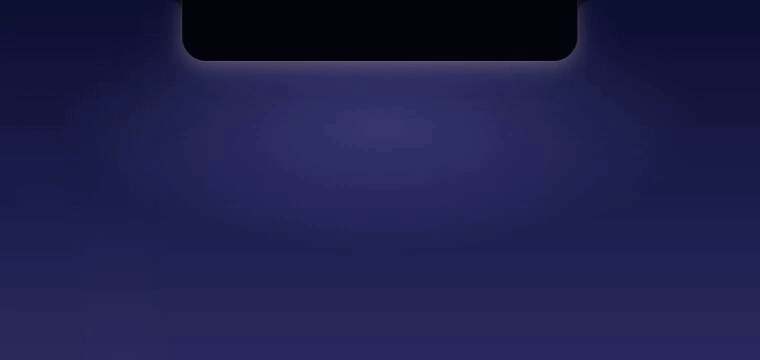
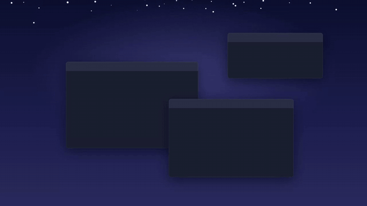
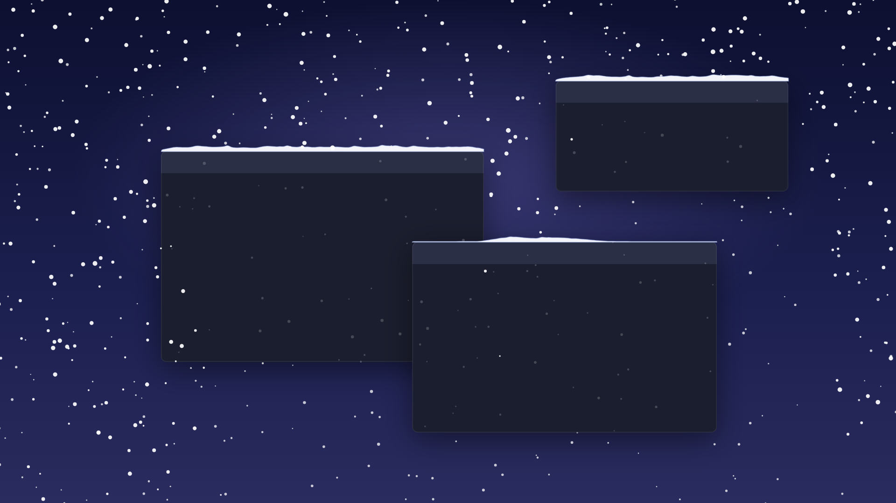
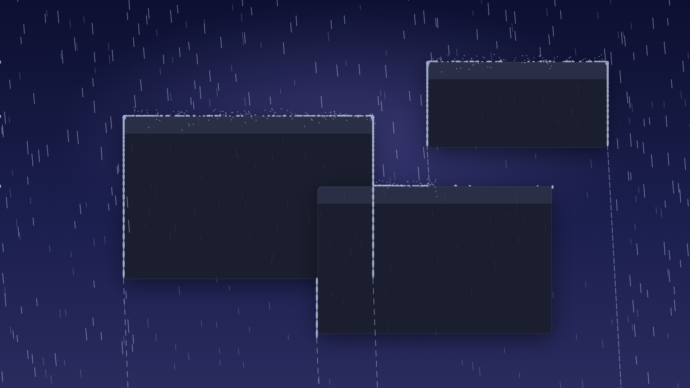
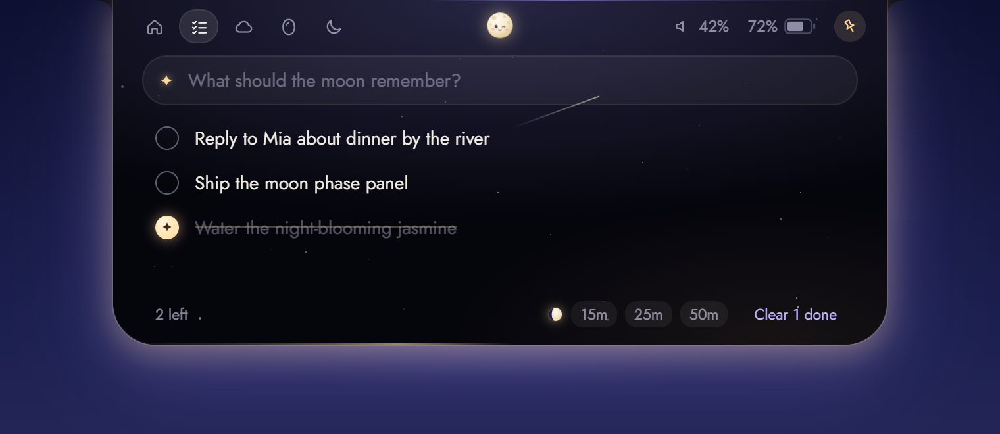
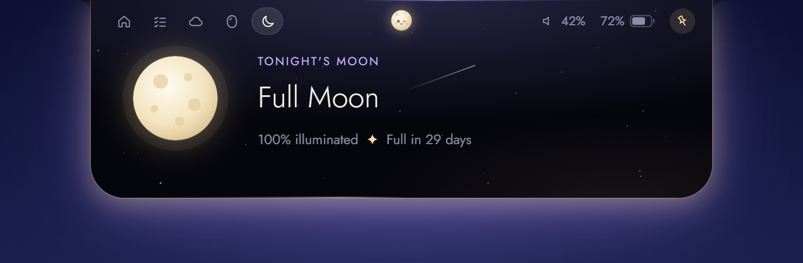
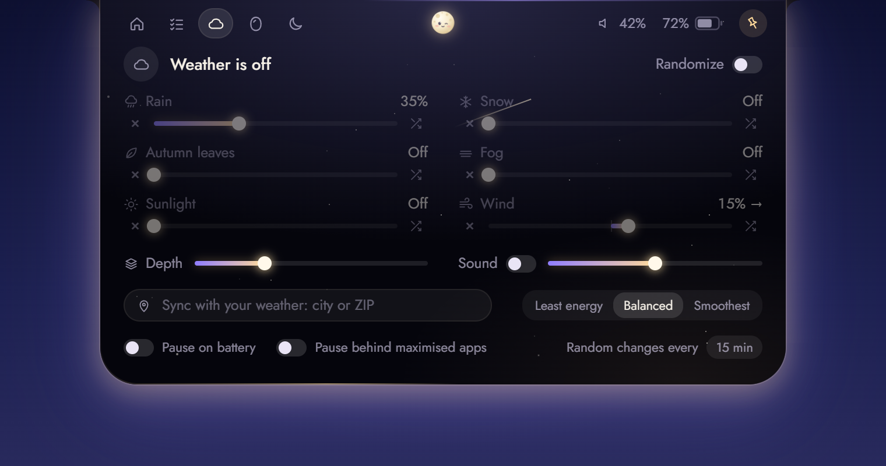

<div align="center">


# Nyx

### A little moon that lives at the top of your screen.

**It sleeps when you're busy, wakes when you come close, plays your music, keeps your to-dos,
and makes it snow on your windows.**

[](https://github.com/ayushmankumar7/nyx/releases/latest)
[](https://github.com/ayushmankumar7/nyx/releases)
[](LICENSE)
[](https://github.com/ayushmankumar7/nyx/stargazers)



<sub>Windows · Tauri v2 + Svelte 5 · MIT · ~zero clicks to love</sub>

<br/>

<a href="https://github.com/ayushmankumar7/nyx/releases/latest/download/Nyx_0.1.0_x64-setup.exe"><b>⬇️ Download for Windows</b></a>
&nbsp;·&nbsp;
<a href="https://github.com/ayushmankumar7/nyx/releases/latest">All releases</a>

<sub>Windows 10/11 (64-bit) · 1.6 MB · installs in seconds, no admin needed</sub>

</div>

> **First launch:** Nyx isn't code-signed yet, so Windows SmartScreen may say *"Windows protected
> your PC"*. Click **More info → Run anyway**. Once it's running, look for the moon at the top of
> your screen and in the system tray.

---

## Your desktop has weather now ❄️

Turn on **Vibes** and Nyx paints living weather over your *whole desktop*. It isn't a
wallpaper. It knows where your windows are.

<p align="center"></p>

<table>
  <tr>
    <td width="50%"></td>
    <td width="50%"></td>
  </tr>
  <tr>
    <td><b>Snow piles up on your windows.</b> Drag a window and the snow rides along. Shake it and the snow tumbles off.</td>
    <td><b>Rain splashes on your title bars,</b> runs along the edges, pools in the corners and falls off in tiny waterfalls.</td>
  </tr>
</table>


**Autumn leaves** drift through sunbeams, settle on your windows and scatter when you swipe the
cursor through them. There's **fog**, **wind** and a **Depth** slider that lets some of the weather
fall *behind* your apps. Nyx can also play gentle synthesised rain and snow sounds.

Flip on **Sync with your weather**, type your city, and your desktop matches the sky outside. When
it's raining outside, it rains on your screen. (Or tick **Invert** and get sunshine on grey days.)

Nobody asked for this. Everyone who sees it wants it.

---

## The island

Nyx turns the top-centre of your display (or your MacBook's notch) into a living island that
stretches, squishes and wobbles like jelly.

<p align="center">
  
  
</p>

When something happens, it pops up for a moment and then tucks itself away again:

<p align="center">
  <br/>
  <br/>
  
</p>

**Hover it and it opens.** Everything you need, one glance away:

<table>
  <tr>
    <td width="50%"></td>
    <td width="50%"></td>
  </tr>
  <tr>
    <td><b>To-dos and focus timers.</b> Press <code>Ctrl+Alt+T</code> from anywhere, type a task, hit Enter and it's gone. Press ▶ on a task to start a focus session.</td>
    <td><b>Tonight's moon.</b> The real phase, how much of it is lit, and how long until it's full.</td>
  </tr>
</table>



### Little things you'll notice

- 🌕 **The moon grows as you focus.** During a focus session, the moon on the pill waxes from crescent to full. When time's up it chimes and Nyx celebrates.
- 🎨 **The panel takes on your album art's colour.**
- 🖱️ **Scroll over the pill to change the volume.** Scroll over the tabs to switch pages.
- 🪞 **Mirror.** A one-hover camera check before your next call.
- 🫥 **It gets out of the way.** It never steals focus and isn't on your taskbar. Clicks pass straight through it, and it hides itself during fullscreen games, videos and presentations.

---

## Build from source

Just want to use it? Grab the installer from [Releases](https://github.com/ayushmankumar7/nyx/releases/latest).
To hack on it:

```sh
npm install
npm run tauri dev
```

On Windows, build with the MSVC Rust toolchain:

```sh
rustup default stable-msvc
# or, per shell:  RUSTUP_TOOLCHAIN=stable-x86_64-pc-windows-msvc npm run tauri dev
```

Nyx doesn't appear on the taskbar. Use the tray icon (the moon) to hide it, toggle launch at login,
or quit.

### Controls

| | |
|---|---|
| Hover the pill | Nyx wakes and the panel opens; move away and it folds up |
| Click the pill | Opens it too (with a squish) |
| Scroll over the pill | Volume |
| Scroll over the tab row | Switch pages |
| Pin (top right) / `Ctrl+Alt+N` | Keep the panel open |
| `Ctrl+Alt+T` | Quick-add a to-do: type, Enter, and it tucks itself away again |
| `Ctrl+Alt+W` | Toggle Vibes (desktop weather) |

Pages: **Home** (now playing, with a seekable progress bar where the player allows it),
**To-do** (saved to `todos.json` in the app data folder), **Vibes**, **Mirror** (camera picker
included) and **Tonight's moon**.

Vibes also has per-effect Random with eased changes. It can pause on battery or behind maximised
windows. Inspired by Weatherling for Mac; all the art and sound here are our own.

**Performance note:** the weather layer is a full-screen transparent WebView, and most of its cost
comes from WebView2's GPU compositing, not the simulation. *Balanced* (30 fps) is the sensible
default; moving to a native Direct2D layer would bring the cost close to zero.

### Designing without the native shell

Run `npm run dev` and open http://localhost:1420 to see the island in a browser with demo data.
Query flags pin a state: `?open&pin`, `?open&pin&tab=sky`, `?activity=volume|charging|track`,
`?media=0`. Keys: `v`/`V` volume, `c` charger, `t` next track, `p` play/pause, `m` toggle media.

Open http://localhost:1420/weather for the weather layer over some pretend windows. Set levels
with query flags, for example `?snow=0.9&rain=0` or `?leaves=0.9&sun=0.4&wind=0.4`.

The screenshots in this README were captured from these previews.

## How it works

- **Overlay** (`src-tauri/src/overlay.rs`): a 760×340 transparent, always-on-top,
  non-focusable window pinned to the top-centre of the primary display. Clicks pass through it.
  A 30 Hz cursor check turns click-through off only while the cursor is over the pill (whose
  rectangle the UI reports via `set_hit_rect`). It hides itself while a fullscreen app, game or
  presentation is active.
- **Media** (`src-tauri/src/media/`): Windows System Media Transport Controls (title, artist,
  artwork, playback position and play/pause/next/previous) for Spotify, browsers and other players.
- **System** (`src-tauri/src/system.rs`): battery/charging and output volume (scroll over the
  island to change volume).
- **UI** (`src/lib/`): `Island.svelte` drives the shape with springs; `Nyx.svelte` is the mascot;
  panels live in `src/lib/panels/`; the weather simulation lives in `src/lib/weather/`.

## Platform status

| | Windows | macOS | Linux |
|---|---|---|---|
| Overlay, hover, click-through | ✅ | builds; notch alignment TODO | X11 ✅; Wayland needs layer-shell (TODO) |
| Hide over fullscreen apps | ✅ | TODO | TODO |
| Now playing + controls | ✅ SMTC | TODO (MediaRemote) | TODO (MPRIS) |
| Volume | ✅ | TODO (CoreAudio) | TODO (PipeWire/Pulse) |
| Battery / charging | ✅ | ✅ `pmset` | ✅ sysfs |
| Mirror, moon phase | ✅ | ✅ | ✅ |

Want Nyx on your Mac or Linux box sooner? The TODOs above are a great place to start. PRs welcome. 🌙

---

<div align="center">

**If Nyx made you smile, a ⭐ helps other people find it.**

MIT © ayushmankumar7

</div>
